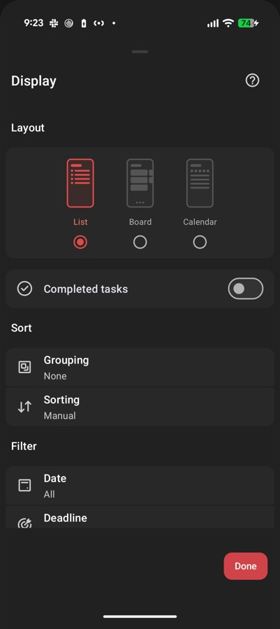
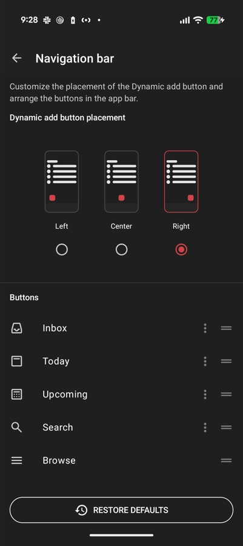
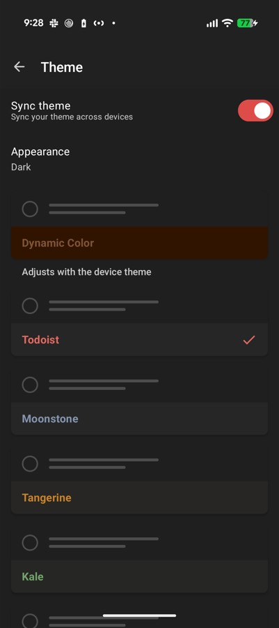
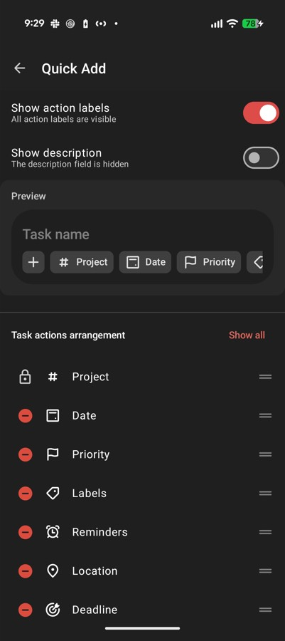
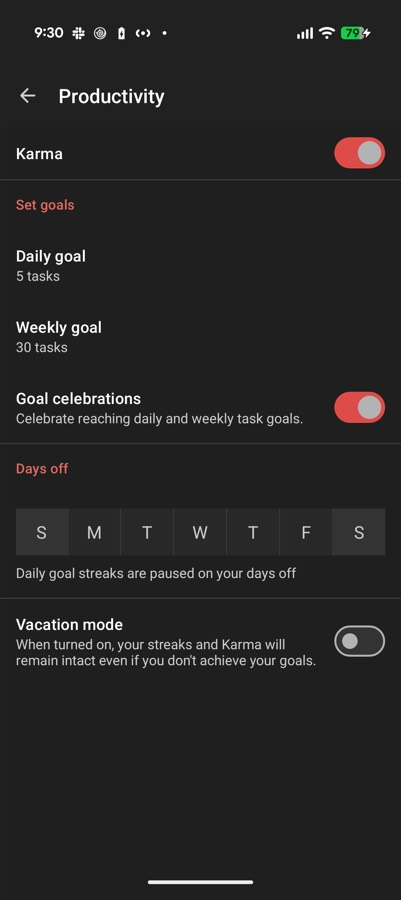

# Design reference: Todoist (Android)

Todoist is one of the three apps D1 names as the bar for Android UI quality. On 2026-11-22 we went through it on the owner's Pixel 10: every tab, the menus, a project, Reporting, Insights, notifications, Filters & Labels and most of Settings. We also recorded its sheets frame by frame and read its accessibility tree. This page records what makes it good, so design work on feedSmith can point to it.

The quality bar (`docs/quality-bar.md`) holds the rules feedSmith must meet. This page is the evidence and the examples behind them. It isn't a template: feedSmith keeps its own identity (D1, D2, D6), and these are principles, not Todoist's look.

Screenshots here are only the ones with no personal content in them. Everything else is described in words.

## The one idea

**A few kinds of building blocks, each used the same way on every screen.** You learn Todoist once.

## 1. Every screen is built the same way

- Every top-level screen (Inbox, Today, Upcoming, a project) has a large left-aligned title and the same two icons at top right: **view options** and **⋮ more**. A summary sits under the title when it helps ("22 tasks · 9h 45m").
- The five-tab bar is identical everywhere. One red **+** floats in the same place on every screen.
- Deeper places (Settings, Reporting, Filters & Labels, a project) are full screens with a ← back arrow.

## 2. Which surface for which job

| Surface | Used for | Examples |
|---|---|---|
| Popup menu, anchored to ⋮ | actions on the current screen | Add section · Copy link · Email tasks · Insights · Activity · Archive · Delete |
| Bottom sheet over the list | anything quick or transient | task detail, Display options, Project Insights, quick add |
| Full screen with ← | places you go to and stay | Settings and each settings page, Reporting, Filters & Labels |

- **Menus are grouped by dividers:** create first, then share, then understand, with destructive actions (Archive, Delete) last.
- **Sheets keep the list dimmed but visible behind them,** so you never lose your place.
  - Task detail opens in about 150 ms and closes in about 100. The tapped row appears to carry into the sheet's title.
  - Its header is a breadcrumb to the project ("# Web & CMS ›"). Rarer actions (Reminders, Deadline, Locations) wait as chips at the bottom.
- **Quick add** is one field that rises with the keyboard, with chips underneath (Inbox, Today, Priority). The date chip defaults to the screen you're on.

## 3. Choices are pictures, not words

- **Display options:** Layout offers List, Board and Calendar as small phone drawings, then Completed tasks, Sort (Grouping, Sorting) and Filter, with a red **Done** button. It's the same sheet on every list screen.
- **Navigation bar settings:** where the + sits (Left, Center, Right) is three phone drawings, and the tabs below reorder by drag handle.
- **Theme:** each theme is previewed as a mini task row in its own colours, and the current one is ticked.

## 4. Settings show their current value without opening

- **Settings are grouped:** Account; **Personalization**; **Productivity**; More. Each group name is in the accent colour.
- **Every row shows its current value as a subtitle:** "Theme · Todoist", "Daily goal · 5 tasks", "When snoozed… · 30 minutes", "Remind me via · Multiple". You can read the whole state without opening anything.
- **A toggle's subtitle describes what it does now,** and changes with its state: "All action labels are visible" versus "The description field is hidden".
- **Quick Add settings include a live preview** of the add bar that updates as you rearrange its actions.

## 5. Reordering always works the same way

Tabs, quick-add actions and projects all reorder by a drag handle (≡) on the right. A fixed item shows a lock, and a removable one a red minus. One gesture with one look, everywhere.

## 6. Colour means something, and there's one accent

- **Dates are coloured by how close they are:** red for Today, orange for Tomorrow, purple for this week ("Wednesday"), grey for later ("Dec 1").
- **A task's checkbox ring is its priority colour** (red, orange, blue, grey).
- **Red is the only accent:** the active tab's pill, the +, toggles, radio buttons, section headers and Done. Everything else is neutral.

## 7. No screen is empty or opaque

- **Search** shows *Recent searches* and *Recently visited* before you type.
- **Project Insights are plain-language cards:** "At risk · 0 tasks · No recommendations available", a progress bar ("99%"), "599 completed · 4 active", and a weekly chart.
- **Limits are stated plainly:** "Labels · USED: 14/500". Subtasks show their progress ("0/7") and are indented under their parent.
- **Reporting is an activity timeline grouped by day,** where each entry has an avatar with a green tick badge.

## 8. Rows: a fixed order, each part with one job

**Each task row has a fixed order:** checkbox, title, optional grey note (one line), meta line (date and time, repeat icon), labels on the left and the project on the right. Every part has a different colour or weight and one job, so a row scans in a glance.

**Swipes preview safely.**
- Dragging a row part way reveals a coloured panel with an icon: teal with a select icon one way, orange with a calendar the other.
- Letting go early snaps the row back, so trying a gesture costs nothing.

## 9. Delight is opt-in and off the main path

Karma, daily and weekly goals, goal celebrations, days off ("Daily goal streaks are paused on your days off") and vacation mode all live under Productivity, and each one can be turned off. Upcoming's week strip pulls down into a whole month by a handle, with dots on days that have tasks.

## 10. Plain words, and real labels

- **Copy** is sentence case and plain, and states consequences.
- **TalkBack labels are real:** checkboxes are "Complete", the back arrow is "Navigate up", ⋮ is "More options", and links are "Hyperlink".

## What feedSmith takes from this

The rules live in `docs/quality-bar.md` (Q29–Q34, added 2026-11-22). In short:

- each part of an Article row has its own voice, and colour carries meaning
- every screen has the same top bar
- a clear rule for menus, sheets and full screens
- settings rows show their state, and visual choices are drawn
- one way to reorder
- no empty zero states

Tickets that apply them first: FEE-42 (Feeds list polish), FEE-30 (Saved and Done: swipe previews, the empty state) and Manage Feeds' rename moving into a sheet.
